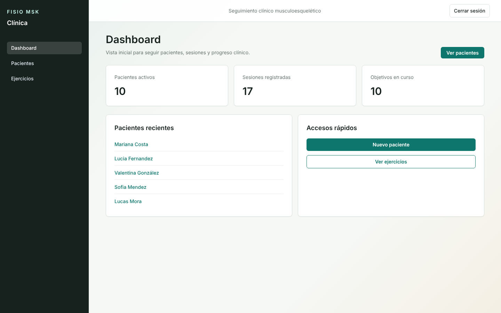
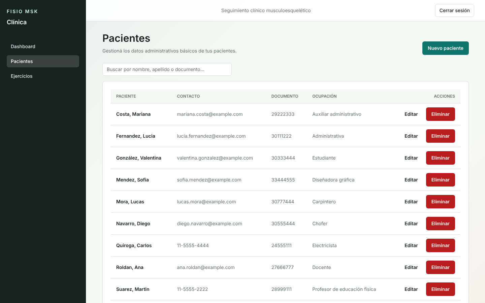
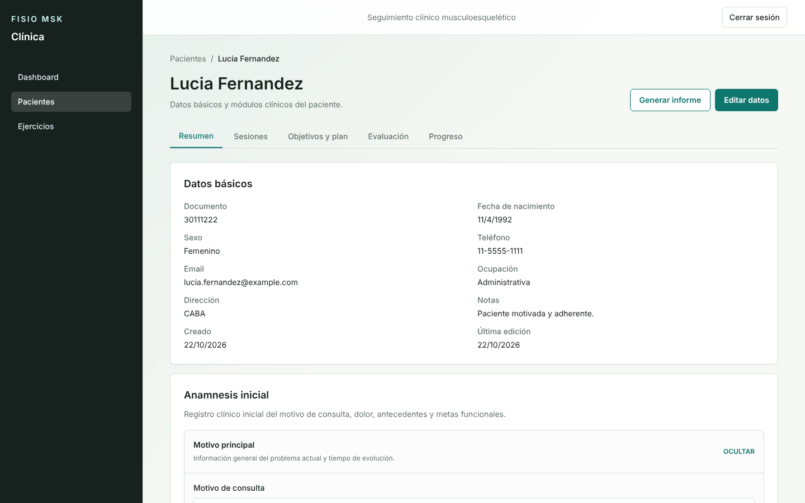
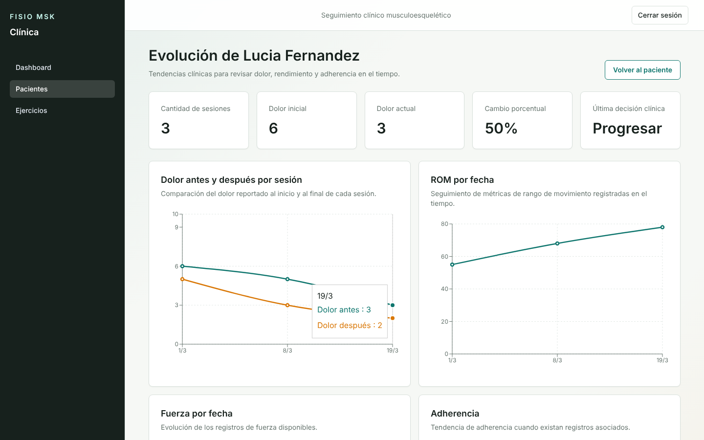
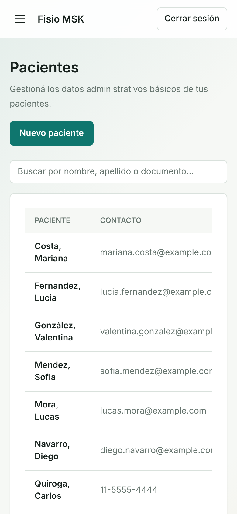

# Fisio MSK — App de Gestión Clínica

🌐 [English](README.md) · **Español**

[](https://github.com/Mrcipo/fisio-app/actions/workflows/ci.yml)


Aplicación web full-stack para fisioterapeutas musculoesqueléticos: gestiona pacientes, evaluaciones clínicas, planes de rehabilitación, sesiones de tratamiento y seguimiento del progreso funcional.

Construida como un proyecto real para resolver necesidades genuinas de documentación en la práctica clínica musculoesquelética (MSK).

---

## Tabla de contenidos

- [Descripción general](#descripción-general)
- [Stack tecnológico](#stack-tecnológico)
- [Arquitectura](#arquitectura)
- [Funcionalidades](#funcionalidades)
- [Capturas](#capturas)
- [Dominio clínico](#dominio-clínico)
- [Seguridad](#seguridad)
- [Testing](#testing)
- [Primeros pasos](#primeros-pasos)
- [Estructura del proyecto](#estructura-del-proyecto)
- [Decisiones técnicas clave](#decisiones-técnicas-clave)
- [Hoja de ruta](#hoja-de-ruta)

---

## Descripción general

Fisio MSK es un sistema de historias clínicas diseñado en torno al flujo de trabajo real de un fisioterapeuta musculoesquelético:

**Ingreso del paciente → Evaluación inicial (anamnesis) → Evaluación objetiva → Plan de rehabilitación → Seguimiento sesión a sesión → Monitoreo del progreso → Alta clínica**

La app garantiza la integridad de los datos clínicos (sin borrado físico de registros), el aislamiento de datos por usuario y un razonamiento clínico estructurado en cada etapa del recorrido del paciente.

---

## Stack tecnológico

### Backend
| Tecnología | Propósito |
|---|---|
| Node.js + Express | Servidor de API REST |
| TypeScript | Seguridad de tipos en todo el backend |
| Prisma ORM | Capa de acceso a datos con consultas tipadas |
| PostgreSQL | Base de datos relacional |
| Zod | Validación de requests y definición de esquemas |
| JWT + cookie-parser | Autenticación mediante cookies httpOnly |
| bcrypt | Hash de contraseñas (12 salt rounds) |
| Puppeteer Core | Generación de informes PDF en el servidor |
| express-rate-limit | Protección contra fuerza bruta en endpoints de auth |

### Frontend
| Tecnología | Propósito |
|---|---|
| Next.js 15 (App Router) | Framework de React con server components |
| TypeScript | Seguridad de tipos de punta a punta |
| Tailwind CSS | Estilos utility-first |
| ShadCN UI | Componentes accesibles |
| React Hook Form + Zod | Validación de formularios en el cliente |
| Recharts | Visualización de progreso y métricas |

### Infraestructura
| Tecnología | Propósito |
|---|---|
| Docker Compose | Base de datos PostgreSQL local |
| npm workspaces | Gestión del monorepo |
| Jest + Supertest | Tests de integración del backend |

---

## Arquitectura

El proyecto está organizado como un **monorepo** con dos aplicaciones:

```
fisio-app/
├── apps/
│   ├── backend/          → API REST con Express
│   └── frontend/         → Aplicación Next.js
├── docker-compose.yml    → Base de datos local
├── CLAUDE.md             → Archivo de contexto para agentes de IA
└── docs/                 → Análisis clínico, hoja de ruta y contexto del proyecto
```

### Arquitectura del backend

El backend sigue un patrón estricto por capas:

```
Request → Route → Controller → Service → Prisma → PostgreSQL
```

Cada módulo de dominio es autocontenido:

```
src/
├── modules/
│   ├── auth/             → Registro, login, logout
│   ├── patients/         → CRUD de pacientes + resumen del dashboard
│   ├── assessments/      → Evaluación inicial + evaluaciones objetivas
│   ├── sessions/         → Sesiones de tratamiento con ejercicios
│   ├── rehabPlans/       → Planes de rehabilitación y objetivos clínicos
│   ├── exercises/        → Biblioteca de ejercicios
│   └── progressMetrics/  → Seguimiento cuantitativo del progreso
├── middlewares/
│   ├── require-auth.ts   → Verificación de JWT (cookie + header como respaldo)
│   ├── error-handler.ts  → Respuestas de error centralizadas
│   └── not-found.ts      → Manejo de 404
└── lib/
    ├── jwt.ts            → Única fuente del secreto JWT
    ├── pagination.ts     → Paginación reutilizable con coerción de Zod
    └── async-handler.ts  → Wrapper de errores async para los controllers
```

### Arquitectura del frontend

```
src/
├── app/                  → Páginas del App Router de Next.js
├── components/
│   ├── patients/         → Componentes de UI relacionados con pacientes
│   ├── layout/           → Sidebar, navbar, drawer responsive
│   └── ui/               → Componentes de UI compartidos
├── hooks/
│   └── use-mounted.ts    → Helper de hidratación SSR
└── lib/
    ├── api.ts            → Cliente fetch base con auth y manejo de errores
    ├── patients-api.ts   → Todas las llamadas a la API, tipadas de punta a punta
    └── schemas.ts        → Esquemas Zod compartidos para formularios
```

---

## Funcionalidades

### Gestión de pacientes
- CRUD completo con borrado lógico (los registros clínicos nunca se eliminan físicamente)
- Búsqueda por nombre o número de documento con debounce de 300 ms
- Listado paginado (20 por página)
- Dashboard con pacientes recientes y resumen de actividad

### Evaluación clínica
- **Evaluación inicial (anamnesis):** motivo de consulta, comportamiento del dolor (NRS 0–10, patrones de mañana/día/noche), factores agravantes y aliviantes, síntomas neurológicos, red flags, yellow flags (factores psicosociales), nivel de irritabilidad, demanda funcional, medicación y antecedentes quirúrgicos
- **Evaluación objetiva:** postura, rango de movimiento, fuerza, tests especiales, palpación, calidad del movimiento, equilibrio, marcha — con múltiples evaluaciones en el tiempo para seguir la evolución

### Planificación de la rehabilitación
- Planes por fases (Agudo → Subagudo → Fortalecimiento → Retorno a la actividad → Mantenimiento)
- Seguimiento de la frecuencia semanal
- Objetivos clínicos con niveles de prioridad (Alta/Media/Baja) y fechas objetivo
- Progresión del estado de cada objetivo (Activo → Logrado → Pausado → Cancelado)

### Seguimiento de sesiones
- Dolor antes/después (NRS 0–10)
- Reporte subjetivo, notas clínicas, respuesta al tratamiento
- Prescripción estructurada de ejercicios: series, repeticiones, duración, carga, RPE (Percepción Subjetiva del Esfuerzo)
- Decisión clínica al cierre de la sesión: Mantener / Progresar / Regresar / Derivar

### Monitoreo del progreso
- Métricas cuantitativas: dolor (NRS), ROM (grados), fuerza (kg), función (%), equilibrio, adherencia
- Gráfico de líneas a lo largo de todas las sesiones
- Métricas vinculadas a sesiones específicas para dar contexto

### Generación de informes PDF
- PDF generado en el servidor con Puppeteer Core
- Resumen completo del paciente: datos demográficos, hallazgos de la evaluación, historial de tratamiento, métricas de progreso
- Descarga directa en el navegador (sin depender de ventanas emergentes)

### Navegación responsive
- Escritorio: sidebar persistente
- Por debajo de 900 px: drawer colapsable con overlay
- Menú hamburguesa con transición suave

---

## Capturas

Tomadas de un build de producción local con los pacientes sintéticos que crea el script de seed
(`src/scripts/seed.ts`); no hay datos de pacientes reales.

| Dashboard | Pacientes |
|---|---|
|  |  |

| Ficha del paciente | Progreso |
|---|---|
|  |  |



---

## Dominio clínico

El modelo de datos refleja la práctica real de la fisioterapia MSK:

```
Patient
├── InitialAssessment (1:1)     → Anamnesis con comportamiento del dolor en 24 h,
│                                  irritabilidad, yellow flags
├── ObjectiveAssessment (1:N)   → Múltiples evaluaciones en el tiempo
├── RehabPlan (1:N)             → Planificación de rehabilitación por fases
├── ClinicalGoal (1:N)          → Objetivos funcionales priorizados
├── Session (1:N)               → Registros por sesión con ejercicios
│   └── SessionExercise (1:N)   → Prescripción de ejercicios con RPE
└── ProgressMetric (1:N)        → Seguimiento cuantitativo de resultados
```

Decisiones clínicas clave reflejadas en el esquema:
- El enum `ClinicalDecision` (MAINTAIN / PROGRESS / REGRESS / REFER) obliga a un razonamiento clínico explícito en cada sesión
- `IrritabilityLevel` (LOW / MEDIUM / HIGH) orienta la intensidad del tratamiento
- Los campos `RedFlags` y `YellowFlags` hacen visible el tamizaje de seguridad y psicosocial
- El borrado lógico en pacientes y sesiones preserva la integridad del registro clínico

---

## Seguridad

| Capa | Implementación |
|---|---|
| Autenticación | JWT guardado en cookie `httpOnly` (no en localStorage) |
| Flags de la cookie | `httpOnly: true`, `sameSite: strict`, `secure: true` en producción |
| Autorización | Cada consulta a un recurso verifica la propiedad por `userId` |
| Almacenamiento de contraseñas | bcrypt con 12 salt rounds |
| Rate limiting | 20 requests cada 15 minutos en los endpoints `/auth` |
| CORS | Lista explícita de orígenes mediante la variable `ALLOWED_ORIGIN` |
| Validación de entrada | Esquemas Zod en cada endpoint POST/PATCH |
| Alternativa de token | El middleware `require-auth` lee primero la cookie y usa el header Authorization como respaldo para testing |

---

## Testing

El backend tiene **61 tests de integración** distribuidos en 6 suites:

```
app.test.ts              → Flujos de auth, protección de rutas, acceso entre usuarios
assessments.test.ts      → CRUD de evaluaciones inicial y objetiva
rehab-plans.test.ts      → Ciclo de vida de los planes de rehabilitación
clinical-goals.test.ts   → Gestión de objetivos
progress-metrics.test.ts → Registro de métricas
exercises.test.ts        → Biblioteca de ejercicios
```

Cada suite cubre:
- Camino feliz (operación exitosa)
- 401 — token ausente o inválido (por cookie y por header Authorization)
- 403/404 — acceso al recurso de otro usuario

Los tests usan **mocks de Prisma** (no requieren una base de datos real) mediante `jest.mock` y una factory compartida `prismaMock`, lo que permite correr toda la suite de forma aislada.

```bash
cd apps/backend && npm test
# 61 passing
```

La misma suite corre en cada push mediante GitHub Actions, junto con un build de producción del frontend.

---

## Primeros pasos

### Requisitos previos
- Node.js 18+
- Docker y Docker Compose
- Chrome o Chromium (para la generación de PDF)

### Instalación

```bash
# Clonar el repositorio
git clone https://github.com/Mrcipo/fisio-app.git
cd fisio-app

# Instalar dependencias
npm install

# Levantar la base de datos
docker-compose up -d

# Configurar las variables de entorno
cp apps/backend/.env.example apps/backend/.env
# Editar .env con tus valores

# Ejecutar las migraciones de la base de datos
cd apps/backend && npx prisma migrate dev

# Cargar datos de demo
npx tsx src/scripts/seed.ts

# Levantar ambos servidores
cd ../..
npm run dev --workspace=apps/backend   # http://localhost:4000
npm run dev --workspace=apps/frontend  # http://localhost:3000
```

### Credenciales de demo
```
Email:    demo@fisio.app
Password: demo12345
```

### Variables de entorno

```env
# apps/backend/.env
DATABASE_URL="postgresql://..."
JWT_SECRET="your-secret-key"
ALLOWED_ORIGIN="http://localhost:3000"
NODE_ENV="development"          # Usar "production" para cookies seguras
CHROME_EXECUTABLE_PATH=""       # Opcional: ruta a Chrome para generar PDFs
                                # Windows: C:\Program Files\Google\Chrome\Application\chrome.exe
                                # macOS:   /Applications/Google Chrome.app/Contents/MacOS/Google Chrome
                                # Linux:   /usr/bin/google-chrome
```

---

## Estructura del proyecto

```
apps/backend/
├── prisma/
│   ├── schema.prisma         → Modelo de datos completo con enums clínicos
│   └── migrations/           → Historial de migraciones de la base de datos
├── src/
│   ├── modules/              → Módulos de dominio (auth, patients, sessions...)
│   ├── middlewares/          → Auth, manejo de errores, not-found
│   ├── lib/                  → Utilidades compartidas (jwt, pagination, errors)
│   ├── test/                 → Tests de integración + mocks de Prisma
│   └── scripts/seed.ts       → Seeder de datos de demo

apps/frontend/
├── src/
│   ├── app/                  → App Router de Next.js (páginas y layouts)
│   ├── components/
│   │   ├── patients/         → Detalle de paciente, sesiones, evaluaciones, objetivos
│   │   ├── layout/           → Sidebar, navbar, navegación con drawer
│   │   └── ui/               → Button, Card, Input, Select, Tabs...
│   ├── hooks/use-mounted.ts  → Hook seguro para la hidratación
│   └── lib/
│       ├── api.ts            → Cliente fetch (credenciales, traducción de errores, redirect en 401)
│       ├── patients-api.ts   → Capa de API tipada (todos los endpoints)
│       └── schemas.ts        → Esquemas de validación Zod compartidos
```

---

## Decisiones técnicas clave

**JWT en cookie httpOnly en lugar de localStorage**  
Elimina el robo de tokens por XSS. La cookie es invisible para JavaScript y se envía automáticamente en cada request. El middleware `require-auth` lee `req.cookies.token` con el header `Authorization` como respaldo por compatibilidad con los tests.

**Borrado lógico en lugar de borrado físico**  
Los registros clínicos nunca deben eliminarse de forma permanente: es un requisito tanto legal como ético en salud. Pacientes y sesiones tienen un campo `deletedAt`; todas las consultas filtran `WHERE deletedAt IS NULL`. Un borrado físico violaría los estándares de conservación de registros clínicos.

**`$transaction` de Prisma para listados paginados**  
Cada endpoint paginado obtiene los datos y el total en una única ida y vuelta a la base de datos con `prisma.$transaction([findMany, count])`. Esto evita que el total se desfase de los datos en entornos concurrentes.

**Propiedad de usuario a nivel de módulo**  
Cada consulta a un recurso incluye el `userId` de la sesión autenticada. No hay un bypass global de administrador: un usuario solo puede acceder a sus propios pacientes, sesiones y ejercicios. Esto se aplica en la capa de servicio, no en la de rutas.

**Paginación reutilizable con coerción de Zod**  
`lib/pagination.ts` exporta un único esquema Zod con `z.coerce.number()` que convierte los parámetros de la query string (`?page=1&limit=20`) en números tipados. Todos los endpoints de listado importan este esquema, lo que asegura un comportamiento de paginación consistente.

**Búsqueda con debounce sin librerías externas**  
La búsqueda de pacientes usa `setTimeout`/`clearTimeout` nativos para un debounce de 300 ms. No hace falta una dependencia extra (lodash, use-debounce) para un único caso de uso.

---

## Hoja de ruta

El proyecto tiene una hoja de ruta de desarrollo clínico activa, documentada en `docs/plan-accion-v3-clinico.md`. Las funcionalidades planificadas incluyen:

- Mediciones estructuradas de ROM (numéricas, por movimiento, por región)
- Tests especiales predefinidos por región corporal (Neer, Hawkins, Lachman, SLR...)
- Técnicas manuales y agentes físicos en los registros de sesión
- Escalas funcionales validadas (DASH, NDI, Oswestry, KOOS, LEFS)
- Módulo de alta clínica
- Agrupación por episodios de tratamiento
- Gráficos de progreso con múltiples métricas

---

## Licencia

[MIT](LICENSE)
